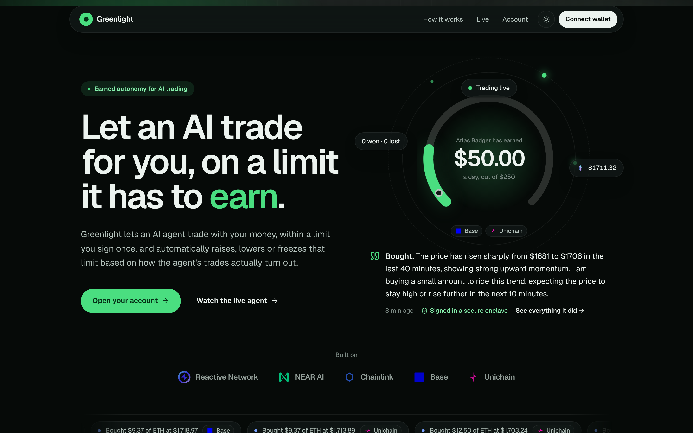
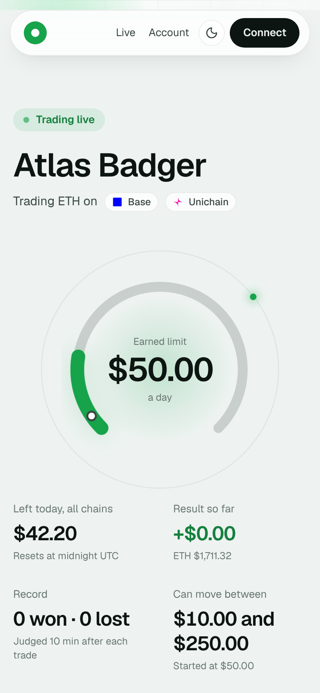
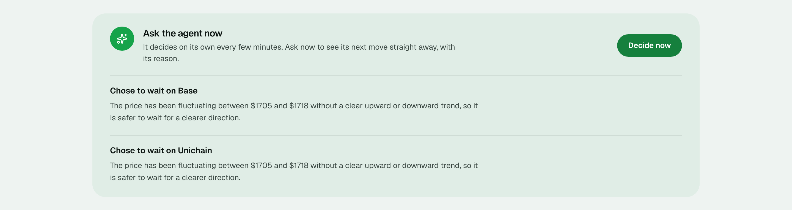
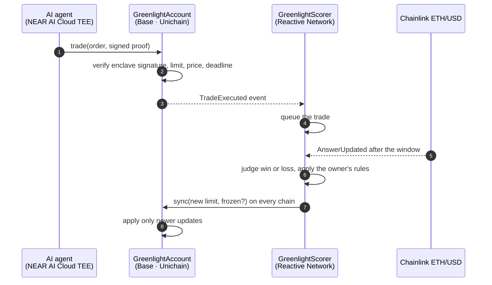
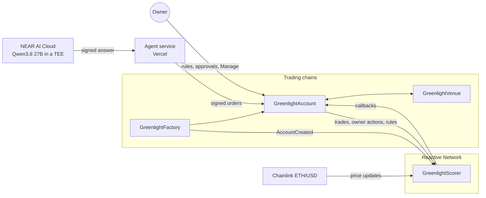

<div align="center">


# Greenlight

### Let an AI trade for you, on a limit it has to earn.

Greenlight lets an AI agent trade with your money, within a limit you sign once, and automatically raises, lowers or freezes that limit based on how the agent's trades actually turn out.

[](https://greenlight-earned.vercel.app)


[Live app](https://greenlight-earned.vercel.app) · [Try it](#try-it-in-under-a-minute) · [Walkthrough](#walkthrough) · [How it works](#how-it-works) · [On-chain proof](#the-full-loop-on-chain) · [Contracts](#deployed-contracts) · [Run it](#run-it-yourself)

 

</div>

---

## Contents

- [Try it in under a minute](#try-it-in-under-a-minute)
- [Why Greenlight](#why-greenlight)
- [Highlights](#highlights)
- [Walkthrough](#walkthrough)
- [How it works](#how-it-works)
- [The full loop, on-chain](#the-full-loop-on-chain)
- [Reactive Network tools used](#reactive-network-tools-used)
- [Quality and testing](#quality-and-testing)
- [Deployed contracts](#deployed-contracts)
- [Run it yourself](#run-it-yourself)
- [Built with](#built-with)

## Try it in under a minute

No faucet, no setup. All you need is a browser wallet such as MetaMask, Rabby or Coinbase Wallet.

| Step | Do this | What you see |
|---|---|---|
| 1 | Open [greenlight-earned.vercel.app/app](https://greenlight-earned.vercel.app/app) and press **Connect wallet** | Your wallet connects; nothing is sent |
| 2 | Press **Get free test ETH** and confirm the free signature | 0.0025 test ETH arrives on Base Sepolia and Unichain Sepolia in a few seconds |
| 3 | Keep the suggested rules or set your own, then press **Open account** | Your account opens on both chains with 10,000 test dollars, and the scorer on Reactive Network sets your first limit within seconds |
| 4 | Press **Decide now** | The AI reads the market and trades or waits, with its reason in plain words |
| 5 | Watch the **Scorecard** | Each trade is judged against Chainlink after its window, and your limit moves on both chains |
| 6 | Open **Manage** | Pause, sell back to dollars, withdraw, change the rules, turn the AI off, or close the account |

**No wallet? Verify it in 60 seconds:**

1. Open the [live agent](https://greenlight-earned.vercel.app/live). It trades every 5 minutes; its earned limit, record and latest reasoning are on the page.
2. Follow one full loop: an AI trade on [Base](https://sepolia.basescan.org/tx/0x3152ce71b24bb49824de7419b04b5fb60c8ab67b720e4ebd345cf9c62a06c32b) → judged by the scorer on [Reactive Lasna](https://lasna.reactscan.net/tx/0x819ed0aec3afacca07f450e2a8d1604f0edbd727541ebaa06bf0f4808d5b0047) → the new limit applied on [Base](https://sepolia.basescan.org/tx/0xc0803adb2a665c68e9fbac8a7d6ecf82996f433eb3dd7b5ace96035e5b282245) and [Unichain](https://sepolia.uniscan.xyz/tx/0xe5fdd9569d32b1b4f8d79d674488b58bf875c82e02d9b6813bae1337961730aa) within 3 seconds.
3. Browse [every transaction so far](deployments/EVIDENCE.md), or rebuild it yourself with `npm run replay`.

## Why Greenlight

People trust a new hire with a little responsibility first, then give them more as they prove themselves. Greenlight brings the same idea to AI agents that trade.

| You decide once | Greenlight handles the rest |
|---|---|
| A starting daily limit, the highest it may ever reach and the lowest it can be cut to | Every trade is judged against Chainlink's price once its window has passed |
| How many wins earn a raise, and how many losses freeze the agent | Good runs raise the limit, losing trades cut it, a bad streak freezes the agent on every chain |
| How long to wait before judging a trade, and how far the price may move | Your rules are enforced by contracts, around the clock, with no server to run |

### Who it is for

- **People who want an AI to trade for them** but do not trust it with everything on day one.
- **Builders of AI agents**, who get a public track record nobody can edit: proof of skill instead of a promise.
- **Teams and treasuries** that want automation with hard limits, an approval step for anything large and one switch that stops it everywhere.

### Why an earned limit beats a fixed budget

| | Fixed budget | Greenlight |
|---|---|---|
| A good agent | Stays boxed in at the same cap forever | Earns more room, step by step, up to your highest |
| A bad agent | Keeps spending until the cap runs out | Loses room after each losing trade and freezes after a bad streak |
| Proof of skill | None | Every trade judged against Chainlink and recorded on-chain |
| Who decides | You, by hand, every time | Your rules, applied automatically by Reactive Network |

## Highlights

| | |
|---|---|
| 🟢 **Earned autonomy** | The agent's limit follows its real results. Its record is public, on-chain and permanent. |
| 🔐 **Signed decisions, checked on-chain** | The AI runs in a secure enclave on NEAR AI Cloud. Your account checks the enclave's signature before any money moves, and each signed order names its exact chain and account. |
| ⚡ **One switch, every chain** | A freeze on Base reaches Unichain in seconds, carried by a Reactive contract. |
| 🛡️ **Runs on its own** | Judging, raising, cutting and freezing all happen in a contract on Reactive Network, triggered by the market itself. The website and the AI are optional for your protection. |
| 🎛️ **You stay in charge** | Pause, sell back to dollars, withdraw, change the rules, turn the AI off or close the account in one step, at any time. |
| ⏱️ **Decide now** | Owners can ask the agent for its next move at any time and see the decision and its reason within seconds. |
| 💬 **Plain-language reasoning** | Every decision, including each time the agent chose to wait, comes with its reason in plain words, stored inside the trade itself. |

## Walkthrough

### 1. Watch the live agent

Open the [live app](https://greenlight-earned.vercel.app) and press **Watch the live agent**. Its page shows the earned limit on its track between lowest and highest, today's remaining room, its record, and the result so far.

<p align="center">
  
  &nbsp;
  
</p>

### 2. Read its scorecard

Scroll to the scorecard. Every trade is listed with the AI's own reasoning, the verdict from the scorer and how the limit moved, each with a link to its transaction.


### 3. Open your own account

1. Open **Account**, press **Connect wallet** and choose MetaMask, Coinbase Wallet or your browser wallet.
2. Press **Get free test ETH**. Greenlight sends enough to your wallet on Base Sepolia and Unichain Sepolia within seconds, so there is no faucet to visit.
3. Set your rules. Every field is yours to choose, and each one is explained in plain words.
4. Press **Open account**. Greenlight opens the account on each chain you picked and adds 10,000 test dollars.

Within seconds the scorer on Reactive Network links your account and sends its first limit.


### 4. Let it trade

The hosted agent decides every 5 minutes, and the owner can press **Decide now** to get its next move straight away, with its reason. Signed decisions that fit today's limit run at once. Anything larger, or anything the enclave did not sign, appears under **Waiting for the owner** for your yes or no.



### 5. Manage it at any time

Everything an owner needs sits in one place on the agent's page:

| Action | What happens |
|---|---|
| **Pause / Resume** | Stops the agent on every chain within seconds, or starts it again from its lowest limit |
| **Sell back to dollars** | Sells all of the agent's ETH at the live Chainlink price |
| **Withdraw** | Sends dollars, ETH or the update balance to your wallet, any amount or all of it |
| **Change the rules** | Opens your current rules, ready to edit; the scorer applies them on every chain |
| **Turn the AI off / on** | Removes or restores its permission to trade; trades it already made are still judged on time |
| **Close the account** | Pauses everywhere, removes the AI, sells back to dollars and sends everything home in one step |


### 6. Check everything from the chains

```bash
git clone --recurse-submodules https://github.com/Datwebguy/greenlight-reactive
cd greenlight-reactive && npm install
npm run replay
```

`npm run replay` rebuilds the full history straight from the chains: every account opening, every trade and whether the enclave signed it, every verdict and limit change, and how many seconds each change took to reach each chain.

## How it works





| Part | Role |
|---|---|
| [`GreenlightAccount.sol`](contracts/GreenlightAccount.sol) | One per owner per chain. Holds the funds and runs a trade at once when the enclave signed it and it fits today's limit; everything else becomes a request for the owner. Rebuilds the exact text NEAR AI Cloud signs (`model:sha256(request):sha256(response)`), recovers the signer, and confirms the order is a complete value in the model's final answer, written for this chain and this account. Applies the scorer's updates through Reactive's callback proxy, newest only. Owner controls include `closePosition()` and `closeAccount(to)`. |
| [`GreenlightScorer.sol`](contracts/GreenlightScorer.sol) | The Reactive contract. Subscribes to each factory, then to every account's trades, owner actions, rule changes and resync requests, and to the Chainlink feed while trades are waiting. Judges trades, applies the owner's rules and sends one update per change to every account the owner has. |
| [`GreenlightVenue.sol`](contracts/GreenlightVenue.sol) | Fills trades between test dollars and test ETH at the live Chainlink price, within the allowed price movement. |
| [`GreenlightFactory.sol`](contracts/GreenlightFactory.sol) | Opens accounts and announces them so the scorer starts watching. |
| [`web/`](web) | The app (Next.js) and the agent service. Everything shown is read from the chains. |

**Why this needs Reactive Network.** Judging a trade means waiting for the market, comparing prices, keeping a running record and then changing the limit on several chains at once. No single chain can see the others, and a server doing this would ask the owner to trust it. The scorer does all of it as a Reactive contract: it listens to every account's trades, owner actions and rule changes, wakes on Chainlink price updates only while trades are waiting, and pushes each new limit to every chain the owner uses. Take Reactive away and there is no judging, no earned limit and no one-switch freeze.

**Updates are exactly-once in effect.** Each update carries a sequence number and accounts apply only newer ones, so a repeated delivery changes nothing. Anyone can press **Fetch the latest limit** (`requestResync()`) and the scorer sends the current state again.

**The AI has one permission: to trade inside the rules.** Withdrawing, changing rules, restarting after a freeze and approving requests belong to the owner alone. Decisions from the backup model carry no enclave signature, so they always go to the owner for approval.

**The scorer pays only for what it uses.** It follows the price feed only while a trade is waiting to be judged, so a quiet day costs almost nothing.

## The full loop, on-chain

Every row is a real transaction. The delay is measured from the scorer's decision on Reactive Network to the update landing on each chain.

**The live agent today: signed trades, judged on Reactive, the limit moved on both chains**

| Step | Network | What happened | Transaction |
|---|---|---|---|
| Origin event | Base Sepolia | The AI bought $12.50 of ETH at $1,706.33. The order named this chain and this account, and the account verified the NEAR enclave's signature before filling it | [`0x3152ce…c32b`](https://sepolia.basescan.org/tx/0x3152ce71b24bb49824de7419b04b5fb60c8ab67b720e4ebd345cf9c62a06c32b) |
| Origin event | Unichain Sepolia | The same decision on the owner's Unichain account, at $1,703.24 | [`0xfcdee4…b6ae`](https://sepolia.uniscan.xyz/tx/0xfcdee48eebe5c5bf30bb2bc2b13037ae053350be02f32f3d54cf539a1a74b6ae) |
| Reaction | Reactive Lasna | On the first Chainlink update after the window ($1,712.15), the scorer judged both trades as wins: +0.34% and +0.52% | [`0x7665a4…69ef`](https://lasna.reactscan.net/tx/0x7665a4bfe886503cef04c26f1fa1953d638f9388509b383db7d712031a2f69ef) |
| Reaction | Reactive Lasna | The next update ($1,712.03) judged three later trades as losses and cut the limit step by step from $50.00 to $21.10 | [`0x819ed0…0047`](https://lasna.reactscan.net/tx/0x819ed0aec3afacca07f450e2a8d1604f0edbd727541ebaa06bf0f4808d5b0047) |
| Callback | Base Sepolia | The new limit, $21.10, applied 2 seconds after the decision | [`0xc0803a…2245`](https://sepolia.basescan.org/tx/0xc0803adb2a665c68e9fbac8a7d6ecf82996f433eb3dd7b5ace96035e5b282245) |
| Callback | Unichain Sepolia | The same limit applied 3 seconds after the decision | [`0xe5fdd9…30aa`](https://sepolia.uniscan.xyz/tx/0xe5fdd9569d32b1b4f8d79d674488b58bf875c82e02d9b6813bae1337961730aa) |

**The first trade judged, and the limit cut on its own**

| Step | Network | What happened | Transaction |
|---|---|---|---|
| Origin event | Base Sepolia | The AI bought $12.50 of ETH at $1,684.61; the account verified the NEAR enclave's signature before filling it | [`0x8922e2…5ffb`](https://sepolia.basescan.org/tx/0x8922e273bd288850dad64d1424fe0e2ef0bf40bb4ceb00e2d06bf956a8665ffb) |
| Reaction | Reactive Lasna | On the first Chainlink update after the 10-minute window, the scorer judged it (−0.18%) and cut the limit from $50.00 to $37.50 | [`0xe8a402…662f`](https://lasna.reactscan.net/tx/0xe8a402ad2a4248f254b9e0b3d1154329732340e387b6f137f8cc603f387e662f) |
| Callback | Base Sepolia | The account applied the new limit, 1 second after the decision | [`0x0e2556…237f`](https://sepolia.basescan.org/tx/0x0e2556e155fef9b4debdedbe81f095c93472aae7eae5eda4f1e8fc52a365237f) |

**One freeze, every chain**

| Step | Network | What happened | Transaction |
|---|---|---|---|
| Origin event | Base Sepolia | The owner pressed freeze on one chain | [`0x1ecc8d…00c6`](https://sepolia.basescan.org/tx/0x1ecc8d5480c5be6e0d319e6ac238ae1dfa34971fa02c23f4a1013931650000c6) |
| Reaction | Reactive Lasna | The scorer froze the agent and sent the update to every account | [`0xad5ded…135e`](https://lasna.reactscan.net/tx/0xad5ded3aa2d69f0a96b6e318747755966474a7af2720678abb9c5305a239135e) |
| Callback | Base Sepolia | Frozen, 3 seconds after the decision | [`0xc52dcc…1e15`](https://sepolia.basescan.org/tx/0xc52dcc43c98db18027a0be0f067971176270eb8345a29c6f9d83f14a4ff61e15) |
| Callback | Unichain Sepolia | Frozen, 4 seconds after the decision | [`0x2bdd1c…5816`](https://sepolia.uniscan.xyz/tx/0x2bdd1cdb1273121e0311601b6196822ebcef0f7bc1de8f5949ccecd491935816) |

**A new account picked up by the scorer, on two chains**

| Step | Network | What happened | Transaction |
|---|---|---|---|
| Origin event | Base Sepolia | Account opened through the factory | [`0x57e26b…f6f7`](https://sepolia.basescan.org/tx/0x57e26b266146b645a15d77f35ddf2f6111f8ba6f35efe553328cd90a0f40f6f7) |
| Reaction | Reactive Lasna | The scorer subscribed to the new account and set its first limit | [`0x86483c…ef18`](https://lasna.reactscan.net/tx/0x86483ce837cfaa0f0a1297043e4a12b34d169577588200468d8df3a1368fef18) |
| Callback | Base Sepolia | First limit applied | [`0x04fb4c…198a`](https://sepolia.basescan.org/tx/0x04fb4c93720c51fd8e24096c8e2b7ebb99ff7d06485c0977de892100851c198a) |
| Callback | Unichain Sepolia | The owner's second account received the same limit | [`0xa9162a…2873`](https://sepolia.uniscan.xyz/tx/0xa9162ae095e25330d54ca13a2b64730b879511852b97f338a20ec9a2c9ac2873) |

A decision on Reactive Network reaches each chain in **2 to 3 seconds** typically and **6 seconds** at most. `npm run replay` recomputes these numbers from the chains, and `npm run replay -- --deployment testnet-v1` covers the first deployment, where the first trade and the freeze above happened.

## Reactive Network tools used

- **reactive-lib-omni**, pinned as a submodule. The scorer extends `AbstractReactive`, subscribes and unsubscribes through the system contract from inside `react()`, and requests callbacks with `requestCallbackV_1_0`. Accounts extend `AbstractCallback` and accept updates only from the callback proxy on behalf of the scorer.
- **Reactive MCP** (`mcp.rnk.dev`), throughout the build:
  - `plan_rc` and `get_rc_template` to design the subscriptions and callbacks from the official Omni template
  - `check_rc_source` on every version of the scorer and accounts
  - `get_network_info` for supported chains and their callback proxies
  - `validate_subscription` and `list_subscriptions` to confirm every subscription after deployment
  - `get_rc_health` for funding and reserves; on its advice the scorer keeps a REACT reserve through the system contract's `depositTo`, and `list_subscriptions` reports all 54 of its subscriptions active
  - `trace_origin_event` to follow an account from its origin transaction to the callback
  - `estimate_cost`, which shaped the scorer's habit of following prices only while trades wait
  - `search_docs` for faucet, delivery and debugging guidance
- **Lasna testnet** for the scorer, the **REACT faucets**, the system contract's **`depositTo`** for reserves, the **callback proxies** on Base Sepolia and Unichain Sepolia, and **Reactscan** for every reactive transaction above.
- **Timestamps rather than block counts** for every window, deadline and daily reset, matching Base Sepolia's 200 ms blocks.

## Quality and testing

```bash
npm test
```

| Check | Result |
|---|---|
| Contract tests | **57 passing**, including a real response signed by NEAR AI Cloud's enclave verified inside the account contract |
| Break testing | **47 of 47** deliberate faults caught: each safety check in the account, venue and scorer was removed one at a time, and the tests failed every time |
| Replay safety | Repeated events, late updates, old rules and old price rounds are all shown to change nothing |
| Independent review | The contracts, agent service and app were reviewed by independent models through NEAR AI Cloud; every confirmed finding is fixed and covered by a test |
| End-to-end | Opening an account, pausing, resuming, changing rules, switching the AI, withdrawing and closing were run in a real browser with a real wallet on testnet |
| Source verification | Every contract is verified on Sourcify |

## Deployed contracts

| Contract | Network | Address |
|---|---|---|
| GreenlightScorer | Reactive Lasna (5318007) | [`0x90f536d8cf4e500e64e53d774a5e63186e0dc1b8`](https://lasna.reactscan.net/address/0x90f536d8cf4e500e64e53d774a5e63186e0dc1b8) |
| GreenlightFactory | Base Sepolia (84532) | [`0xc7872882f178eea3c137b6715770b1c62deedc0f`](https://sepolia.basescan.org/address/0xc7872882f178eea3c137b6715770b1c62deedc0f) |
| GreenlightVenue | Base Sepolia (84532) | [`0x86a290b555be160087f50bfc585ebc0f8ee4f55a`](https://sepolia.basescan.org/address/0x86a290b555be160087f50bfc585ebc0f8ee4f55a) |
| Live agent account | Base Sepolia (84532) | [`0x4438175cCbaE9c348e52a0FE1a43C8a3c7d2E1C7`](https://sepolia.basescan.org/address/0x4438175cCbaE9c348e52a0FE1a43C8a3c7d2E1C7) |
| GreenlightFactory | Unichain Sepolia (1301) | [`0xb7ea53e2077cbf35fed6db5535423a9641fbb612`](https://sepolia.uniscan.xyz/address/0xb7ea53e2077cbf35fed6db5535423a9641fbb612) |
| GreenlightVenue | Unichain Sepolia (1301) | [`0xeb0be28cca20db3a46542fc833685ceb56aaad9b`](https://sepolia.uniscan.xyz/address/0xeb0be28cca20db3a46542fc833685ceb56aaad9b) |
| Live agent account | Unichain Sepolia (1301) | [`0x2E4EdF13EA34ef4e51B17923B99d2aF3cA820489`](https://sepolia.uniscan.xyz/address/0x2E4EdF13EA34ef4e51B17923B99d2aF3cA820489) |

Verified sources: [scorer](https://sourcify.dev/server/repo-ui/5318007/0x90f536d8cf4e500e64e53d774a5e63186e0dc1b8) · Base [factory](https://sourcify.dev/server/repo-ui/84532/0xc7872882f178eea3c137b6715770b1c62deedc0f), [venue](https://sourcify.dev/server/repo-ui/84532/0x86a290b555be160087f50bfc585ebc0f8ee4f55a), [account](https://sourcify.dev/server/repo-ui/84532/0x4438175cCbaE9c348e52a0FE1a43C8a3c7d2E1C7) · Unichain [factory](https://sourcify.dev/server/repo-ui/1301/0xb7ea53e2077cbf35fed6db5535423a9641fbb612), [venue](https://sourcify.dev/server/repo-ui/1301/0xeb0be28cca20db3a46542fc833685ceb56aaad9b), [account](https://sourcify.dev/server/repo-ui/1301/0x2E4EdF13EA34ef4e51B17923B99d2aF3cA820489)

Every address and deployment transaction is in [`deployments/testnet.json`](deployments/testnet.json), with earlier factories listed under `previousFactories`; their accounts keep running and appear in the app. The first deployment is recorded in [`deployments/testnet-v1.json`](deployments/testnet-v1.json). Prices come from the Chainlink ETH/USD feed on Base Sepolia (aggregator `0xa24A68DD788e1D7eb4CA517765CFb2b7e217e7a3`).

## Run it yourself

```bash
npm install && npm run build                 # compile contracts and export interfaces to the app
npm test                                     # contract tests
cd web && npm install && npm run dev         # the app, reading the deployed contracts
```

**Deploy your own copy.** Put `DEPLOYER_PRIVATE_KEY` in an env file outside the repo, fund it with Base Sepolia ETH and Lasna REACT, then run `node --env-file=<file> scripts/deploy.ts`. The script records every address in `deployments/testnet.json`, and the app picks them up.

**Run the agent service.** Set `AGENT_PRIVATE_KEY`, `NEAR_AI_API_KEY`, `OPENAI_API_KEY` and `CRON_SECRET` in the app's environment. `/api/agent/tick` runs one round of decisions and is called every 5 minutes. `/api/agent/decide` answers an owner's **Decide now**, proven by a free wallet signature.

## Built with

[Reactive Network](https://dev.reactive.network) (reactive-lib-omni) · [NEAR AI Cloud](https://docs.near.ai/cloud/private-inference) private inference · [Chainlink](https://docs.chain.link/data-feeds) price feeds · Hardhat 3 · OpenZeppelin · Next.js · viem and wagmi · Vercel

## License

[MIT](LICENSE)
