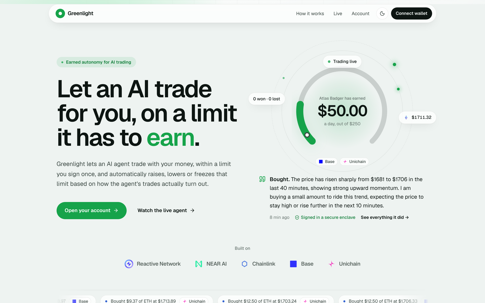
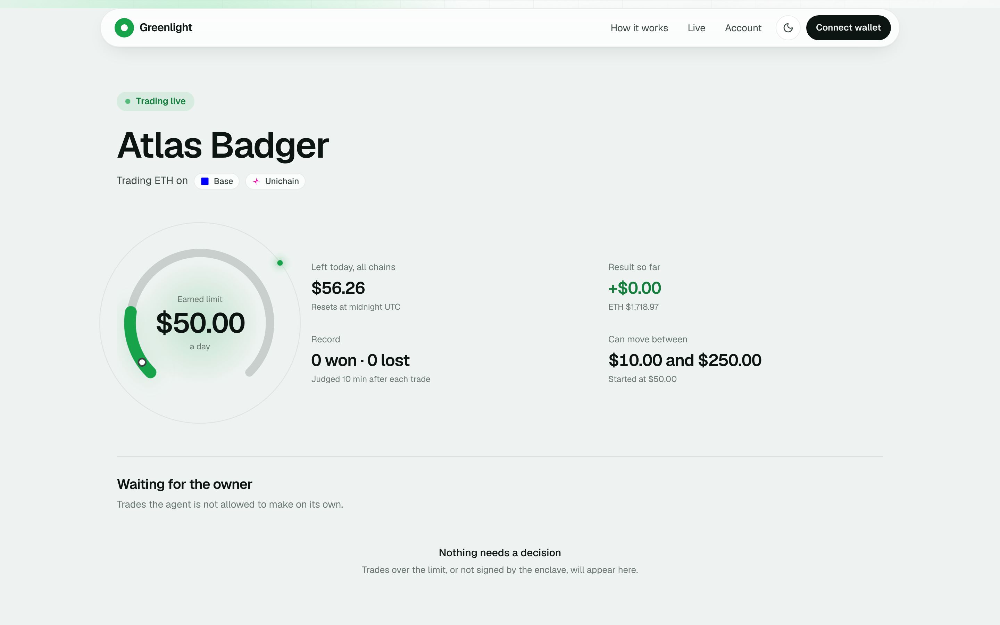
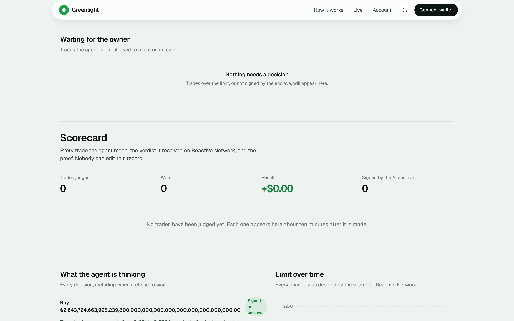
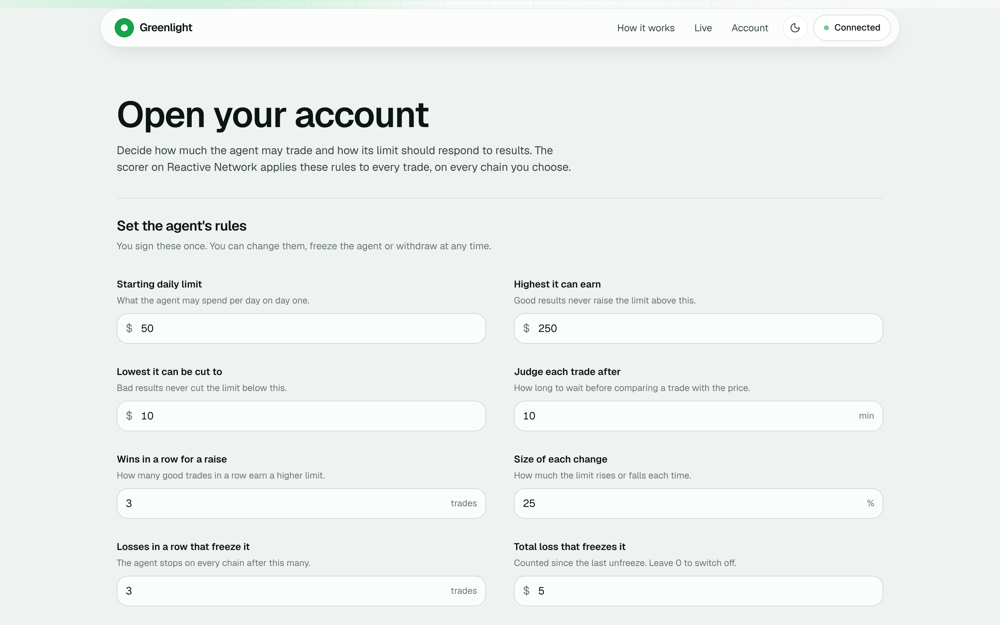
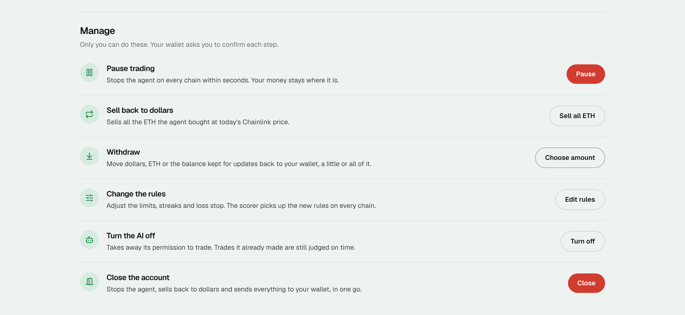
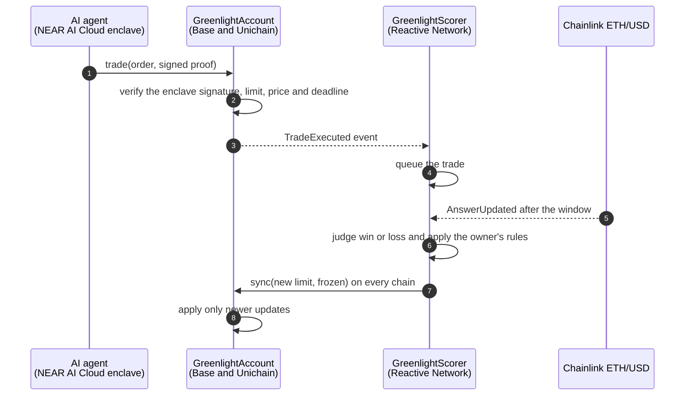

<div align="center">


# Greenlight

**An AI that trades for you, on a limit it has to earn.**

You set the boundaries. Reactive Network makes the decisions in between.

[](https://greenlight-earned.vercel.app)
[](https://greenlight-earned.vercel.app/live)

[](https://github.com/Datwebguy/greenlight-reactive/actions/workflows/test.yml)


[Live app](https://greenlight-earned.vercel.app) · [Try it](#try-it) · [How it works](#how-it-works) · [On-chain proof](#on-chain-proof) · [Contracts](#deployed-contracts) · [Run it yourself](#run-it-yourself)

<picture>
  <source media="(prefers-color-scheme: dark)" srcset="docs/images/home-dark.png" />
  
</picture>

</div>

---

## Contents

1. [Overview](#overview)
2. [Try it](#try-it)
3. [A tour of the app](#a-tour-of-the-app)
4. [How it works](#how-it-works)
5. [Reactive Network integration](#reactive-network-integration)
6. [On-chain proof](#on-chain-proof)
7. [Quality and testing](#quality-and-testing)
8. [Deployed contracts](#deployed-contracts)
9. [Run it yourself](#run-it-yourself)
10. [Built with](#built-with)

## Overview

Greenlight lets an AI agent trade with your money within a limit you sign once, and it raises, lowers or freezes that limit automatically based on how the agent's trades actually turn out.

The next step for on-chain systems is not more automation but delegation: people define their intent and boundaries, and contracts make the continuous decisions in between. Greenlight applies that idea to AI agents. You decide how much freedom the agent may ever have and when it must stop, and a Reactive contract decides, trade by trade and on every chain, how much of that freedom the agent has earned so far.

AI agents are becoming capable enough to trade and manage money, yet there is still no good way to trust one. Today you either hand an agent full control of your wallet and hope it never makes a costly mistake, or you approve every trade yourself, which removes most of the reason for having an agent at all. Everywhere else, trust is earned over time: a new hire starts with small responsibilities and a new driver begins with a learner's permit. Greenlight applies the same principle to AI.

You set the rules once: a starting daily limit, the highest the limit may ever reach, the lowest it can be cut to, how long to wait before judging a trade, and when the agent should freeze. The AI then trades inside that limit, while a contract on Reactive Network judges every trade against Chainlink prices. A run of good trades raises the limit, each losing trade cuts it, and a losing streak or a large total loss freezes the agent on every chain within seconds.

### What makes it different

**The agent earns its freedom.** Its limit is not a fixed number but a record that grows or shrinks with every judged trade. That record follows the owner across every account and chain, so a poor run cannot be wiped away by starting fresh.

**Every decision is verified before money moves.** The AI runs inside a secure enclave on NEAR AI Cloud, which signs each answer. The account contract checks that signature on-chain, along with the order itself, which names the exact chain and account it was made for. Anything unsigned, or larger than today's limit, waits for the owner's approval.

**Every agent has a public scorecard.** Each trade, verdict and change to the limit is written on-chain, together with the AI's reasoning in plain words. Anyone can check how an agent earned its limit, and nobody can edit that record.

**Your protection does not depend on the AI.** The AI only proposes trades. Judging, adjusting the limit and freezing all run as a contract on Reactive Network, triggered by the market itself, so they keep working even if the AI or this website goes offline.

**You stay in charge.** At any time you can pause the agent, sell its ETH back to dollars, withdraw, change the rules, turn the AI off or close the account and receive everything in one step. You can also ask the agent for its next move with **Decide now** and see its decision and reasoning within seconds.

### Who it is for

Greenlight is for people who would like an AI to trade for them but are not ready to trust it with everything on day one. It also serves builders of AI agents, who gain a public track record that proves their agent's skill rather than claiming it, and teams that want automation with hard limits, an approval step for large moves and a single switch that stops everything.

## Try it

The fastest way to see Greenlight is the one-tap check on the home page, which needs no wallet. Press **Pause it everywhere** and a real agent is paused on Base Sepolia; you then watch the scorer on Reactive Network carry that pause to Base and Unichain within a few seconds, with a link to every transaction. The agent restarts on its own afterwards.

To run an agent of your own, you only need a browser wallet such as MetaMask, Rabby or Coinbase Wallet. The whole process takes under a minute and no faucet is required.

| Step | What to do | What happens |
|---|---|---|
| 1 | Open [the app](https://greenlight-earned.vercel.app/app) and press **Connect wallet** | Your wallet connects and nothing is sent |
| 2 | Press **Get free test ETH** and confirm the free signature | 0.0025 test ETH arrives on Base Sepolia and Unichain Sepolia within seconds |
| 3 | Keep the suggested rules or set your own, then press **Open account** | Your account opens on both chains with 10,000 test dollars, and the scorer sets your first limit |
| 4 | Press **Decide now** | The AI reads the market and either trades or waits, explaining why |
| 5 | Watch the **Scorecard** | Each trade is judged against Chainlink once its window has passed, and your limit moves on both chains |
| 6 | Open **Manage** | Pause, sell back to dollars, withdraw, change the rules, turn the AI off or close the account |

You can also follow the [live agent](https://greenlight-earned.vercel.app/live), which decides every twenty minutes, browse [every transaction so far](deployments/EVIDENCE.md), or rebuild the full history from the chains yourself with `npm run replay`.

## A tour of the app

### The live agent

The agent's page shows its earned limit on a track between the owner's lowest and highest values, along with what is left for today, its record and its result so far. Everything on the page is read directly from the chains.

<p align="center">
  
  &nbsp;
  
</p>

### The scorecard

Every judged trade appears on the scorecard with the price it was made at, the price it was judged at, the verdict and a link to each transaction. **Why it traded** opens the AI's own reasoning, which is read from the trade transaction itself.



### Opening an account

After connecting a wallet and receiving free test ETH, a new owner chooses their rules. Each field is explained in plain words, and every value can be changed later.



### Decide now

Press **Decide now** whenever you like, and the agent reads the market and makes its next move, with its reasoning, within seconds.


### Managing the agent

Everything an owner needs is in one place. Pausing stops the agent on every chain within seconds, and restarting it begins again from the lowest limit. Selling back converts all of the agent's ETH to dollars at the live Chainlink price. Withdrawals can return any amount of dollars, ETH or the balance kept for updates. Changing the rules opens the current values ready to edit, and the scorer applies them on every chain. Turning the AI off removes its permission to trade while its existing trades are still judged on time. Closing the account does all of this in one step and sends everything back to the owner's wallet.



## How it works



The system has four contracts and one service.

**GreenlightAccount** ([source](contracts/GreenlightAccount.sol)) is deployed once per owner on each chain and holds the owner's funds. When the agent submits a trade, the account rebuilds the exact text that NEAR AI Cloud signs, recovers the signer and confirms that the order appears as a complete value in the model's final answer, written for this chain and this account. A signed trade within today's limit runs immediately; anything else becomes a request for the owner. The account receives the scorer's updates through Reactive's callback proxy and applies only newer ones.

**GreenlightScorer** ([source](contracts/GreenlightScorer.sol)) is the Reactive contract at the heart of the system. It subscribes to each factory, then to every account's trades, owner actions, rule changes and resync requests, and to the Chainlink feed while trades are waiting to be judged. It judges each trade against the first price after its window, applies the owner's rules and sends one update per change to every account the owner holds.

**GreenlightVenue** ([source](contracts/GreenlightVenue.sol)) fills trades between test dollars and test ETH at the live Chainlink price, within the price movement the owner allows, and **GreenlightFactory** ([source](contracts/GreenlightFactory.sol)) opens accounts and announces them so the scorer can begin watching.

The **agent service** ([web](web)) runs alongside the Next.js app. It reads prices and limits, asks Qwen3.8 27B running in a NEAR AI Cloud enclave for a decision, and submits the signed answer to the account.

### Why this needs Reactive Network

Greenlight is a cross-chain reactive hook in the most literal sense: activity on one network triggers a response on another, with no bridge and no relayer. A trade or a pause on Base becomes a decision on Reactive Lasna, and that decision lands on every chain the owner uses within seconds. It is also a protection mechanism, because a run of losses or a large total loss stops the agent everywhere at once.


Judging a trade means waiting for the market, comparing prices, keeping a running record and then changing the limit on several chains at once. No single chain can see the others, and a server performing this work would ask the owner to trust it. The scorer does all of it as a Reactive contract: it listens to every account, wakes on Chainlink price updates only while trades are waiting, and pushes each new limit to every chain the owner uses. Without Reactive there would be no judging, no earned limit and no single switch that stops the agent everywhere.

### Design principles

Updates are safe to repeat. Each one carries a sequence number and accounts apply only newer values, so a repeated delivery changes nothing, and anyone can call `requestResync()` to receive the current state again.

The AI holds one permission only: to trade inside the rules. Withdrawing, changing rules, restarting after a freeze and approving requests all belong to the owner. Decisions from the backup model carry no enclave signature, so they always wait for the owner's approval.

The scorer pays only for what it uses. It follows the price feed while a trade is waiting to be judged and unsubscribes as soon as the queue is empty, so a quiet day costs almost nothing.

## Reactive Network integration

Greenlight is built on reactive-lib-omni, pinned as a submodule at `3ade0dc`, and was planned, checked and diagnosed with Reactive MCP throughout development. The table below links each part of the integration to the code that implements it.

| Integration point | Where |
|---|---|
| The scorer extends `AbstractReactive` from reactive-lib-omni | [GreenlightScorer.sol:13](contracts/GreenlightScorer.sol#L13), [.gitmodules](.gitmodules) |
| `react()` accepts calls only from the system contract and holds all of the judging logic | [GreenlightScorer.sol:163](contracts/GreenlightScorer.sol#L163) |
| The contract subscribes itself through `SYSTEM.subscribe`, including to new accounts discovered from factory events | [GreenlightScorer.sol:198](contracts/GreenlightScorer.sol#L198), [GreenlightScorer.sol:420](contracts/GreenlightScorer.sol#L420) |
| The Chainlink feed is followed only while trades wait, then unsubscribed | [GreenlightScorer.sol:326](contracts/GreenlightScorer.sol#L326) |
| Results are sent with `SYSTEM.requestCallbackV_1_0`, one update to every account the owner holds | [GreenlightScorer.sol:396](contracts/GreenlightScorer.sol#L396), [GreenlightScorer.sol:408](contracts/GreenlightScorer.sol#L408) |
| Accounts extend `AbstractCallback` and accept updates only from the callback proxy carrying the scorer's address | [GreenlightAccount.sol:17](contracts/GreenlightAccount.sol#L17), [GreenlightAccount.sol:282](contracts/GreenlightAccount.sol#L282) |
| Sequence numbers make repeated deliveries harmless, and `requestResync()` recovers a lost update | [GreenlightAccount.sol:282](contracts/GreenlightAccount.sol#L282), [GreenlightAccount.sol:301](contracts/GreenlightAccount.sol#L301) |
| Repeated trade events are recognised and counted once | [GreenlightScorer.sol:219](contracts/GreenlightScorer.sol#L219) |
| Each price update judges a bounded number of trades, keeping every reaction within its gas limit | [GreenlightScorer.sol:281](contracts/GreenlightScorer.sol#L281) |
| Reserves are funded through the system contract's `depositTo`, and the scorer can also pay from its own balance | [deploy.ts](scripts/deploy.ts) |
| Every timer uses timestamps rather than block numbers, which is checked on every push | [test.yml](.github/workflows/test.yml) |

Reactive MCP was used at every stage. `plan_rc` and `get_rc_template` shaped the subscription and callback design from the official Omni template, `check_rc_source` reviewed every version of the contracts, and `get_network_info` supplied the supported chains and callback proxies. After deployment, `validate_subscription` and `list_subscriptions` confirmed that all 54 of the scorer's subscriptions are active, `get_rc_health` guided the scorer's REACT reserve, and `trace_origin_event` followed a new account from its origin transaction to the callback. The advice from `estimate_cost` is the reason the scorer follows prices only while trades are waiting.

## On-chain proof

Every row below is a real transaction. Delays are measured from the scorer's decision on Reactive Network to the update landing on each chain.

### The live agent: signed trades, judged on Reactive, the limit adjusted on both chains

| Step | Network | What happened | Transaction |
|---|---|---|---|
| Origin | Base Sepolia | The AI bought $12.50 of ETH at $1,706.33. The order named this chain and account, and the account verified the enclave's signature before filling it | [`0x3152ce…c32b`](https://sepolia.basescan.org/tx/0x3152ce71b24bb49824de7419b04b5fb60c8ab67b720e4ebd345cf9c62a06c32b) |
| Origin | Unichain Sepolia | The same decision on the owner's Unichain account, filled at $1,703.24 | [`0xfcdee4…b6ae`](https://sepolia.uniscan.xyz/tx/0xfcdee48eebe5c5bf30bb2bc2b13037ae053350be02f32f3d54cf539a1a74b6ae) |
| Reaction | Reactive Lasna | On the first Chainlink update after the window, the scorer judged both trades as wins, at +0.34% and +0.52% | [`0x7665a4…69ef`](https://lasna.reactscan.net/tx/0x7665a4bfe886503cef04c26f1fa1953d638f9388509b383db7d712031a2f69ef) |
| Reaction | Reactive Lasna | The next update judged three later trades as losses and cut the limit step by step from $50.00 to $21.10 | [`0x819ed0…0047`](https://lasna.reactscan.net/tx/0x819ed0aec3afacca07f450e2a8d1604f0edbd727541ebaa06bf0f4808d5b0047) |
| Callback | Base Sepolia | The new limit of $21.10 applied two seconds after the decision | [`0xc0803a…2245`](https://sepolia.basescan.org/tx/0xc0803adb2a665c68e9fbac8a7d6ecf82996f433eb3dd7b5ace96035e5b282245) |
| Callback | Unichain Sepolia | The same limit applied three seconds after the decision | [`0xe5fdd9…30aa`](https://sepolia.uniscan.xyz/tx/0xe5fdd9569d32b1b4f8d79d674488b58bf875c82e02d9b6813bae1337961730aa) |

### One freeze reaching every chain

| Step | Network | What happened | Transaction |
|---|---|---|---|
| Origin | Base Sepolia | The owner paused the agent on one chain | [`0x1ecc8d…00c6`](https://sepolia.basescan.org/tx/0x1ecc8d5480c5be6e0d319e6ac238ae1dfa34971fa02c23f4a1013931650000c6) |
| Reaction | Reactive Lasna | The scorer froze the agent and sent the update to every account | [`0xad5ded…135e`](https://lasna.reactscan.net/tx/0xad5ded3aa2d69f0a96b6e318747755966474a7af2720678abb9c5305a239135e) |
| Callback | Base Sepolia | Frozen three seconds after the decision | [`0xc52dcc…1e15`](https://sepolia.basescan.org/tx/0xc52dcc43c98db18027a0be0f067971176270eb8345a29c6f9d83f14a4ff61e15) |
| Callback | Unichain Sepolia | Frozen four seconds after the decision | [`0x2bdd1c…5816`](https://sepolia.uniscan.xyz/tx/0x2bdd1cdb1273121e0311601b6196822ebcef0f7bc1de8f5949ccecd491935816) |

### A new account linked by the scorer on two chains

| Step | Network | What happened | Transaction |
|---|---|---|---|
| Origin | Base Sepolia | An account was opened through the factory | [`0x57e26b…f6f7`](https://sepolia.basescan.org/tx/0x57e26b266146b645a15d77f35ddf2f6111f8ba6f35efe553328cd90a0f40f6f7) |
| Reaction | Reactive Lasna | The scorer subscribed to the new account and set its first limit | [`0x86483c…ef18`](https://lasna.reactscan.net/tx/0x86483ce837cfaa0f0a1297043e4a12b34d169577588200468d8df3a1368fef18) |
| Callback | Base Sepolia | The first limit was applied | [`0x04fb4c…198a`](https://sepolia.basescan.org/tx/0x04fb4c93720c51fd8e24096c8e2b7ebb99ff7d06485c0977de892100851c198a) |
| Callback | Unichain Sepolia | The owner's second account received the same limit | [`0xa9162a…2873`](https://sepolia.uniscan.xyz/tx/0xa9162ae095e25330d54ca13a2b64730b879511852b97f338a20ec9a2c9ac2873) |

### Speed

Across 30 measured owner actions, an update reached Base in a median of **1.9 seconds** and Unichain in **3.9 seconds** from the owner's transaction, and all 30 arrived on both chains. The method and every transaction are published in [LATENCY.md](docs/LATENCY.md) and [latency.csv](docs/data/latency.csv). A complete history of the live agents is kept in [EVIDENCE.md](deployments/EVIDENCE.md).

## Quality and testing

The contract suite contains 67 tests and runs on every push, covering 98% of the contract code. Among them is a test that verifies a real response signed inside NEAR AI Cloud's enclave within the account contract, alongside tests showing that repeated events, late updates, old rules and old price rounds change nothing. Property tests replay hundreds of random histories of wins and losses and confirm that the limit never leaves the owner's range and that the owner's chosen losing streak always freezes the agent.

To confirm the tests guard what matters, every safety check in the account, venue and scorer was removed one at a time and the suite was run against each broken version. All 47 deliberate faults were caught. The contracts, agent service and app were also reviewed by an independent model through NEAR AI Cloud, and every confirmed finding was fixed and covered by a test. Finally, the full user journey, from an empty wallet to opening, managing and closing an account, was exercised in a real browser with real wallets on testnet.

The details of each check are recorded in [REVIEW.md](docs/REVIEW.md). To run the tests yourself:

```bash
npm test
```

## Deployed contracts

| Contract | Network | Address |
|---|---|---|
| GreenlightScorer | Reactive Lasna (5318007) | [`0x90f536d8cf4e500e64e53d774a5e63186e0dc1b8`](https://lasna.reactscan.net/address/0x90f536d8cf4e500e64e53d774a5e63186e0dc1b8) |
| GreenlightFactory | Base Sepolia (84532) | [`0xc7872882f178eea3c137b6715770b1c62deedc0f`](https://sepolia.basescan.org/address/0xc7872882f178eea3c137b6715770b1c62deedc0f) |
| GreenlightVenue | Base Sepolia (84532) | [`0x86a290b555be160087f50bfc585ebc0f8ee4f55a`](https://sepolia.basescan.org/address/0x86a290b555be160087f50bfc585ebc0f8ee4f55a) |
| Live agent account | Base Sepolia (84532) | [`0x4438175cCbaE9c348e52a0FE1a43C8a3c7d2E1C7`](https://sepolia.basescan.org/address/0x4438175cCbaE9c348e52a0FE1a43C8a3c7d2E1C7) |
| GreenlightFactory | Unichain Sepolia (1301) | [`0xb7ea53e2077cbf35fed6db5535423a9641fbb612`](https://sepolia.uniscan.xyz/address/0xb7ea53e2077cbf35fed6db5535423a9641fbb612) |
| GreenlightVenue | Unichain Sepolia (1301) | [`0xeb0be28cca20db3a46542fc833685ceb56aaad9b`](https://sepolia.uniscan.xyz/address/0xeb0be28cca20db3a46542fc833685ceb56aaad9b) |
| Live agent account | Unichain Sepolia (1301) | [`0x2E4EdF13EA34ef4e51B17923B99d2aF3cA820489`](https://sepolia.uniscan.xyz/address/0x2E4EdF13EA34ef4e51B17923B99d2aF3cA820489) |

Every contract is verified on Sourcify, so anyone can compare the published source with the deployed code: the [scorer](https://sourcify.dev/server/repo-ui/5318007/0x90f536d8cf4e500e64e53d774a5e63186e0dc1b8); on Base, the [factory](https://sourcify.dev/server/repo-ui/84532/0xc7872882f178eea3c137b6715770b1c62deedc0f), [venue](https://sourcify.dev/server/repo-ui/84532/0x86a290b555be160087f50bfc585ebc0f8ee4f55a) and [account](https://sourcify.dev/server/repo-ui/84532/0x4438175cCbaE9c348e52a0FE1a43C8a3c7d2E1C7); and on Unichain, the [factory](https://sourcify.dev/server/repo-ui/1301/0xb7ea53e2077cbf35fed6db5535423a9641fbb612), [venue](https://sourcify.dev/server/repo-ui/1301/0xeb0be28cca20db3a46542fc833685ceb56aaad9b) and [account](https://sourcify.dev/server/repo-ui/1301/0x2E4EdF13EA34ef4e51B17923B99d2aF3cA820489).

All addresses and deployment transactions are recorded in [testnet.json](deployments/testnet.json), where earlier factories are listed under `previousFactories`; their accounts continue to run and appear in the app. Prices come from the Chainlink ETH/USD feed on Base Sepolia, aggregator `0xa24A68DD788e1D7eb4CA517765CFb2b7e217e7a3`.

## Run it yourself

Clone the repository with its submodule, install the dependencies and run the tests:

```bash
git clone --recurse-submodules https://github.com/Datwebguy/greenlight-reactive
cd greenlight-reactive
npm install && npm run build     # compile the contracts and export their interfaces to the app
npm test                         # run the contract tests
npm run replay                   # rebuild the full history from the chains
```

To start the app against the deployed contracts:

```bash
cd web && npm install && npm run dev
```

To deploy your own copy, place `DEPLOYER_PRIVATE_KEY` in an environment file outside the repository, fund that wallet with Base Sepolia ETH and Lasna REACT, and run `node --env-file=<file> scripts/deploy.ts`. The script records every address in `deployments/testnet.json`, and the app picks them up automatically.

The agent service needs `AGENT_PRIVATE_KEY`, `NEAR_AI_API_KEY`, `OPENAI_API_KEY` and `CRON_SECRET` in the app's environment. The `/api/agent/tick` endpoint runs one round of decisions and is called every twenty minutes for the live agent, while `/api/agent/decide` answers an owner's **Decide now**, verified by a free wallet signature.

## Built with

[Reactive Network](https://dev.reactive.network) with reactive-lib-omni and Reactive MCP, [NEAR AI Cloud](https://docs.near.ai/cloud/private-inference) private inference, [Chainlink](https://docs.chain.link/data-feeds) price feeds, Base and Unichain, Hardhat 3, OpenZeppelin, Next.js, viem, wagmi and Vercel.

## License

Released under the [MIT License](LICENSE).
